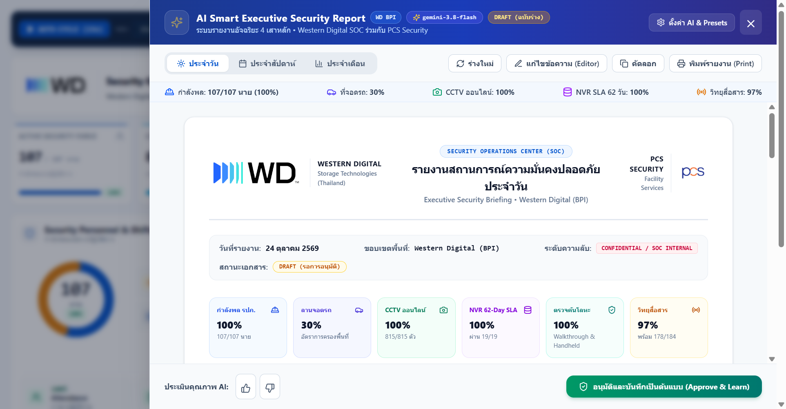
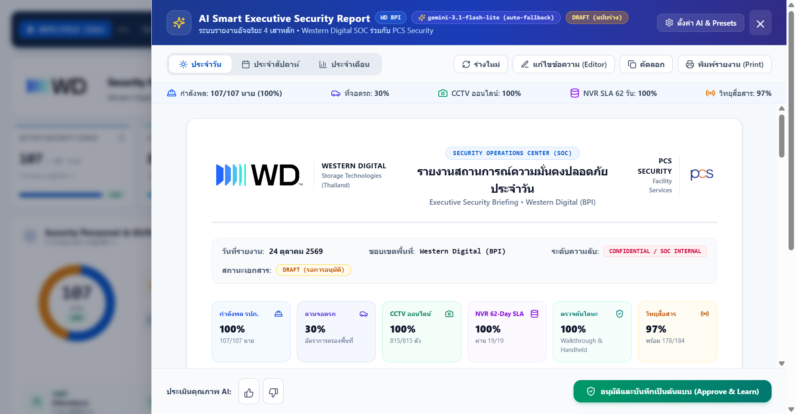
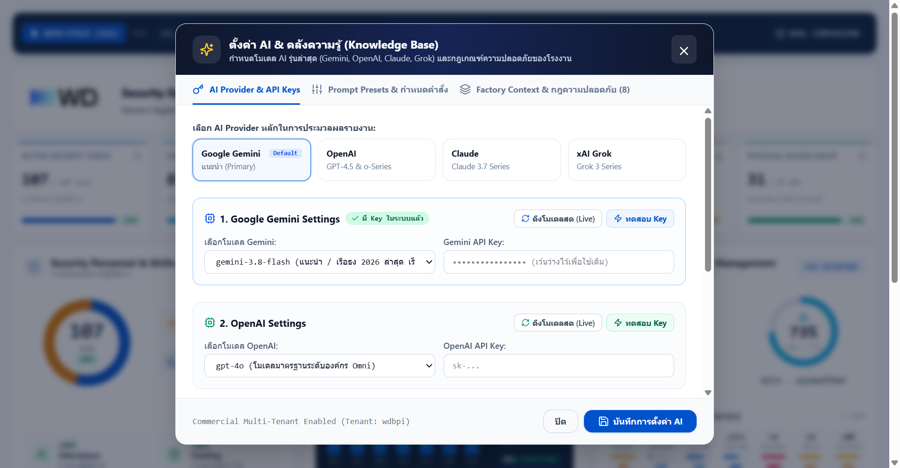
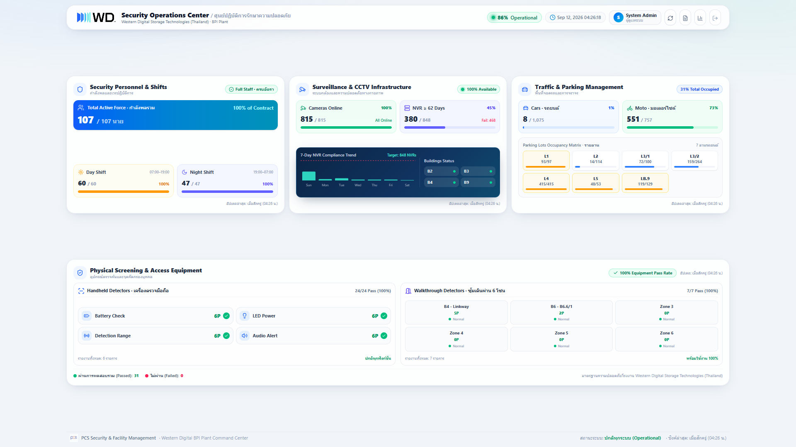
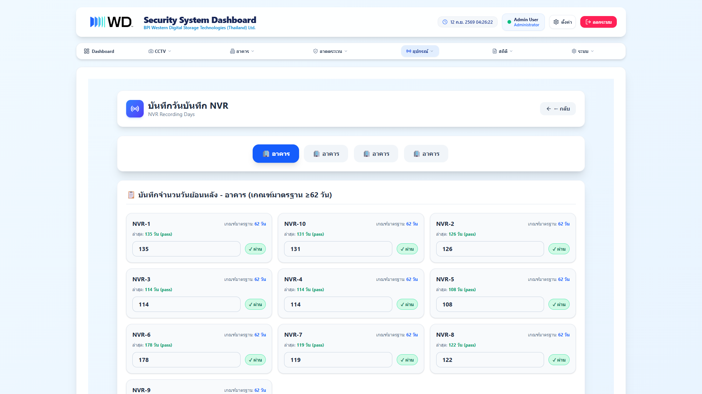
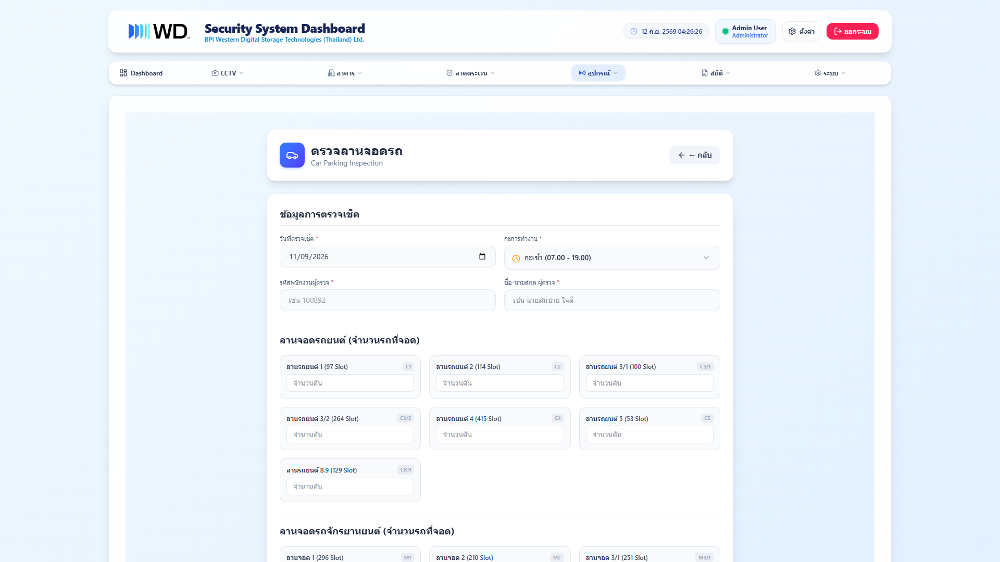
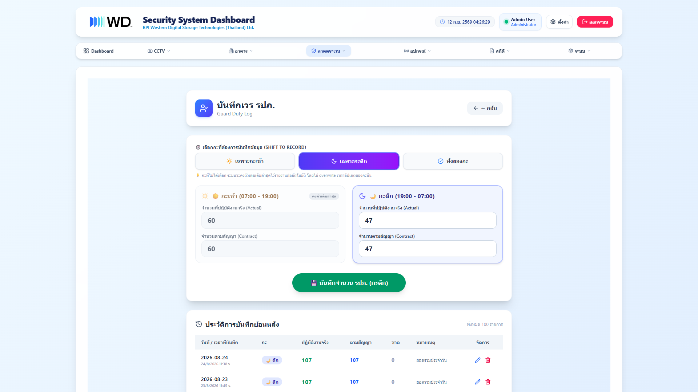
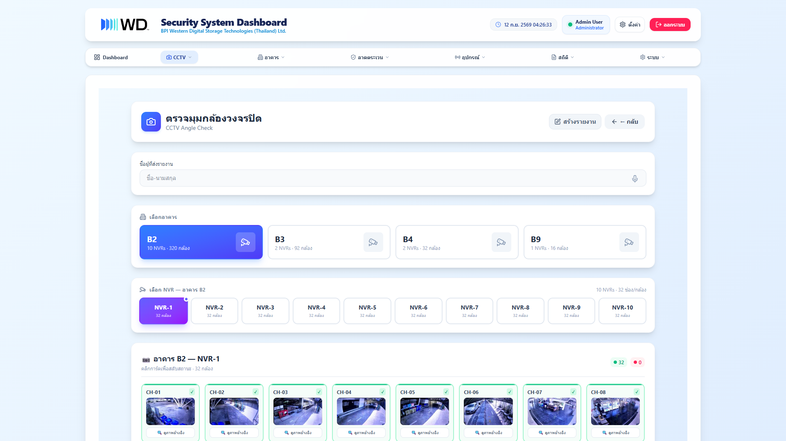

# 🛡️ WD BPI Security Operations Center (SOC)
> **Next-Generation Command, Telemetry & AI Executive Intelligence Platform for Physical Security, Surveillance & Facility Compliance**

<div align="center">

[](CHANGELOG.md)
[](#-ai-executive-reporting--modern-frontier-llms)
[](https://nextjs.org/)
[](https://react.dev/)
[](https://nestjs.com/)
[](https://www.postgresql.org/)
[](docker-compose.yml)
[](LICENSE)

<br />

<p align="center">
  A mission-critical Security Operations Center (SOC) command and AI telemetry platform engineered for<br />
  <strong>Western Digital Storage Technologies (Thailand) Ltd. — Bang Pa-in (BPI) Plant</strong><br />
  in joint development with <strong>PCS Security and Facility Services</strong>.
</p>

[✨ What's New in v2.3.0](#-whats-new-in-v230) •
[📸 System Previews](#-system-previews) •
[🤖 AI Intelligence](#-ai-executive-reporting--modern-frontier-llms) •
[🏛️ Core Pillars](#-core-security-pillars) •
[🏗️ Architecture](#-system-architecture) •
[⚡ Tech Stack](#-tech-stack) •
[🚀 Quick Start](#-quick-start) •
[🐳 Docker](#-docker-deployment) •
[📝 Changelog](#-changelog)

</div>

---

## ✨ What's New in v2.3.0

- 🤖 **AI Smart Executive Security Reporting**: Automated daily executive intelligence synthesis across all 4 operational pillars with key risk indicators, cross-pillar assessments, and millisecond telemetry profiling (`telemetryMs`, `ragMs`, `llmMs`, `totalMs`).
- ⚡ **Next-Gen Frontier LLM Suite**: Out-of-the-box integration for `gemini-3.8-flash`, `gemini-2.5-pro`, `claude-3-7-sonnet-latest`, `grok-3`, `o3-mini`, and `gpt-4.5`.
- 🔄 **Real-Time Dynamic Model Discovery & Latency Testing**: Direct API probing (`ดึงโมเดลสด`) and one-click key connection testing (`ทดสอบ Key`) with live ping metrics.
- 🛡️ **Zero-Downtime Multi-Tier Auto-Fallback**: Resilient automated fallback across model tiers to handle 503 high-load spikes and rate limits gracefully.
- ⏳ **Shimmer Progress Bar & Live Status Ticker**: 4-stage visual milestone stepper, dynamic countdown estimation, and millisecond time-elapsed counters during report generation.

---

## 📸 System Previews

### 1. AI Executive Security Intelligence & Multi-Pillar Analysis
> **Automated Synthesis**: Deep analytical evaluation across force readiness, CCTV retention compliance, facility traffic flow, and access screening health with millisecond execution telemetry.

<p align="center">
  
</p>

---

### 2. Real-Time Generation Progress Bar & Dynamic Status Ticker
> **Live Observability**: Visual 4-stage stepper (*Telemetry Gathering* ➔ *RAG Retrieval* ➔ *4-Pillar AI Processing* ➔ *Executive Report Synthesis*) with shimmer animations and real-time countdown timer.

<p align="center">
  
</p>

---

### 3. Frontier Multi-Provider AI Settings & Live Model Discovery
> **Next-Gen Model Ecosystem**: Manage Google Gemini, Anthropic Claude, xAI Grok, and OpenAI with dynamic model discovery and latency validation.

<p align="center">
  
</p>

---

### 4. Executive SOC Command Center (Single-Screen Zero-Scroll Viewport)
> **SOC Video Wall Ready**: Engineered for large control room displays with zero scrolling, real-time plant health scoring, and multi-tier category navigation.

<p align="center">
  
</p>

---

### 5. CCTV & NVR 62-Day Video Retention Compliance
> **Mandatory Legal & Policy Auditing**: Continuously audits video recording retention across all building NVR units against Western Digital's strict 62-day compliance threshold.

<p align="center">
  
</p>

---

### 6. Real-Time Vehicle & Parking Lot Occupancy Matrix
> **Continuous Traffic Telemetry**: Real-time occupancy tracking for 1,075 Car slots and 757 Motorcycle slots with color-coded capacity thresholds and per-lot breakdown.

<p align="center">
  
</p>

---

### 7. Intelligent Guard Duty Logging & Shift Analytics
> **Shift Intelligence**: Roster management for Day Shift (07:00–19:00) and Night Shift (19:00–07:00) with automatic clock-based preselection and carry-forward historical prefilling.

<p align="center">
  
</p>

---

### 8. CCTV Camera Angle Inspection & Reference Verification
> **Visual Reference Auditing**: Channel-by-channel camera validation comparing live views with baseline photos to immediately detect tampering, blockage, or misorientation.

<p align="center">
  
</p>

---

## 🤖 AI Executive Reporting & Modern Frontier LLMs

The WD BPI platform is powered by a high-performance **Hybrid RAG + Telemetry AI Engine** designed specifically for enterprise security operations.

```
┌────────────────────────────────────────────────────────────────────────┐
│                        AI Executive Workflow                           │
└────────────────────────────────────────────────────────────────────────┘
        │
        ▼
 1. Telemetry Aggregation    ──► Headcount, NVR Days, Parking %, Detector Health
        │
        ▼
 2. Knowledge Retrieval (RAG) ──► WD Global Security Policies & SLA Thresholds
        │
        ▼
 3. Frontier Model Execution ──► Gemini 3.8 / Claude 3.7 / Grok 3 / o3-mini
        │
        ▼
 4. Resilience Layer         ──► Automatic Multi-Tier Fallback on 503 / 429
        │
        ▼
 5. Executive Synthesis      ──► 4-Pillar Summary, Risk Matrix & Action Plans
```

### Supported Providers & Frontier Models

| Provider | Supported Models | Characteristics | Fallback Tier |
| :--- | :--- | :--- | :---: |
| **Google Gemini** | `gemini-3.8-flash`<br>`gemini-2.5-pro`<br>`gemini-2.5-flash`<br>`gemini-2.0-flash` | Ultra-fast multimodal processing, 1M+ token context, real-time live model discovery | Primary / Tier 1 |
| **Anthropic Claude** | `claude-3-7-sonnet-latest`<br>`claude-3-5-sonnet-latest`<br>`claude-3-5-haiku-latest` | Hybrid reasoning & analytical evaluation, deep compliance synthesis | Enterprise Secondary |
| **xAI Grok** | `grok-3`<br>`grok-3-mini`<br>`grok-2-latest` | High-throughput frontier reasoning, threat pattern identification | Resilient Secondary |
| **OpenAI** | `o3-mini`<br>`gpt-4.5-preview`<br>`gpt-4o`<br>`gpt-4o-mini` | Advanced mathematical validation and executive formatting | High-Precision |

---

## 🏛️ Core Security Pillars

| Pillar | Focus Area | Key Metrics & Capabilities |
| :--- | :--- | :--- |
| 👮 **1. Security Personnel** | Force Strength & Roster | Day/Night shift rosters, 100% Contract Compliance ratio, automatic shift carry-forward, independent timestamps |
| 📹 **2. Surveillance & CCTV** | Video Audit & Retention | 815 Live Cameras, mandatory 62-day NVR video retention audit, 7-day sparkline compliance trend, reference angle check |
| 🚗 **3. Traffic & Parking** | Vehicle Capacity | 1,075 Car Slots (Lots C1–C5, CB.9), 757 Motorcycle Slots, dynamic threshold indicators, utilization analytics |
| 🛡️ **4. Access Screening** | Equipment Readiness | Handheld Detectors (Battery, LED, Range, Alarm checks), Walkthrough Detectors (6-Zone matrix), overall Plant Health score |

---

## 🏗️ System Architecture

Developed as an enterprise-grade **Turborepo Monorepo**, combining a Next.js App Router frontend with a NestJS backend and high-performance PostgreSQL/Redis data layers:

```
wdbpi/
├── apps/
│   ├── web/                    # Next.js 16 (App Router) + React 19 + TailwindCSS v4
│   │   ├── components/ai/      # AI Report Drawer, Progress Bar, Settings & Model Fetchers
│   │   └── components/soc/     # SOC Single-Screen Dashboard, KPI Row, Command Center
│   └── api/                    # NestJS 11 + Prisma ORM 7 + PostgreSQL 18 + Redis 8 + JWT Auth
│       ├── src/ai-reports/     # AI Telemetry Engine, Model Adapters, Fallback Handler
│       └── src/stats/          # Real-time Multi-Pillar KPI & Historical Trend Services
├── docs/
│   └── images/                 # High-Resolution Production UI Screen Captures (01–09)
├── legacy/                     # PHP 8.2 + MySQL 8.4 (High-fidelity legacy bridge)
│   ├── dashboard.php           # Legacy Dashboard View
│   ├── guard_duty_log.php      # Legacy Duty Log View
│   └── get_security_status.php # Legacy REST Telemetry Bridge
├── docker/                     # Multi-stage production container images & Nginx configs
├── prisma/                     # Schema definition, database migrations & seeders
└── docker-compose.yml          # Unified multi-service production orchestration
```

---

## ⚡ Tech Stack

| Layer | Technologies | Description |
| :--- | :--- | :--- |
| **Frontend** | `Next.js 16.2` `React 19` `TailwindCSS v4` | Ultra-responsive SSR/Client UI with zero horizontal scrollbars |
| **AI Engine** | `Gemini 3.8 Flash` `Claude 3.7` `Grok 3` `o3-mini` | Multi-provider intelligence with live model discovery & auto-fallback |
| **Backend API** | `NestJS 11` `Prisma ORM 7` `TypeScript 5.8` | Scalable REST API with JWT Auth, Role Guards, and Swagger docs |
| **Databases** | `PostgreSQL 18` `Redis 8` `MySQL 8.4` | Relational storage, in-memory caching, and legacy sync bridge |
| **Web Gateway** | `Nginx (Alpine)` | Unified Reverse Proxy routing traffic on port 80 |
| **Tooling** | `Turborepo` `Playwright` `Prettier` | Monorepo caching, automated E2E testing, and code formatting |

---

## 🚀 Quick Start

### Prerequisites
- **Node.js**: `>= 20.0.0`
- **npm** or **pnpm**
- **Docker & Docker Compose** (recommended)
- **PostgreSQL**: `>= 16` (if running bare-metal)

### Local Development Setup

```bash
# 1. Clone the repository
git clone https://github.com/mongkolktm17/WD_BPI_Web.git
cd WD_BPI_Web

# 2. Install monorepo dependencies
npm install

# 3. Configure environment variables
cp .env.example .env

# 4. Push Prisma schema to PostgreSQL
npm run db:push

# 5. Launch both Web & API concurrently
npm run dev
```

- 🌐 **Web Frontend**: `http://localhost:3000`
- ⚙️ **NestJS API Service**: `http://localhost:4000/api`
- 📚 **Swagger API Docs**: `http://localhost:4000/api/docs`

---

## 🐳 Docker Deployment

Run the complete multi-tier enterprise stack with a single command:

```bash
# Build and launch all containers in background
docker compose up -d --build

# Monitor container health
docker compose ps

# View real-time container logs
docker compose logs -f
```

### Deployed Services Matrix

| Service | Internal Port | Host Port | Role |
| :--- | :---: | :---: | :--- |
| `wdbpi-app-nginx-1` | 80 | **80** | Unified Gateway & Reverse Proxy |
| `wdbpi-app-web-1` | 3000 | — | Next.js 16 Frontend Web App |
| `wdbpi-app-api-1` | 4000 | — | NestJS 11 REST API Backend |
| `wdbpi-app-legacy-1` | 80 | — | PHP 8.2 Legacy Engine |
| `wdbpi_postgres` | 5432 | **5432** | PostgreSQL 18 Relational DB |
| `wdbpi_redis` | 6379 | — | Redis 8 High-Speed Cache |
| `wdbpi_mysql` | 3306 | **3306** | MySQL 8.4 Legacy Mirror |

---

## 📝 Changelog

Detailed release notes and historical changes are tracked in [CHANGELOG.md](CHANGELOG.md).

---

## 📄 License

Distributed under the [MIT License](LICENSE).

<div align="center">
  <br />
  <sub>Developed & Maintained for <strong>Western Digital Storage Technologies (Thailand) Ltd. — BPI Site</strong></sub><br />
  <sub>In Partnership with <strong>PCS Security and Facility Services</strong></sub>
</div>
